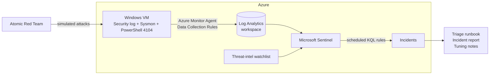

# Microsoft Sentinel SOC Lab

A cloud-based SOC lab that detects and investigates attacks on a Windows VM in Azure. Windows Security and Sysmon logs are sent to Microsoft Sentinel. Custom KQL detections there, each mapped to MITRE ATT&CK, raise incidents for common attacker techniques. Every detection is triggered safely with Atomic Red Team. Each incident is then triaged, written up with a verdict and an escalation decision, and the rule is tuned to cut false positives.

> **Status:** In progress. See the [build checklist](docs/setup.md).

## Architecture



| Component | Purpose |
|---|---|
| Azure Windows VM | The endpoint being monitored. RDP is restricted to a single IP and the VM auto-shuts down every night. |
| Sysmon | Process creation and command-line telemetry (SwiftOnSecurity config) |
| Windows Security event log | Logon failures, account and group changes, log clearing |
| Azure Monitor Agent + DCRs | Sends logs to the `SecurityEvent` and `Event` tables |
| Microsoft Sentinel | Analytics rules, incidents, watchlists |
| Atomic Red Team | Safe, repeatable simulation of each technique |

## Detection matrix

| # | Detection | MITRE ATT&CK | Data source | Trigger | Rule | Report |
|---|---|---|---|---|---|---|
| 1 | Security log cleared | [T1070.001](https://attack.mitre.org/techniques/T1070/001/) Defense Evasion | Security 1102, System 104 | T1070.001 | _planned_ | _planned_ |
| 2 | New local admin account | [T1136.001](https://attack.mitre.org/techniques/T1136/001/), [T1098](https://attack.mitre.org/techniques/T1098/) Persistence | Security 4720 → 4732 | T1136.001 | _planned_ | _planned_ |
| 3 | Encoded PowerShell execution | [T1059.001](https://attack.mitre.org/techniques/T1059/001/), [T1027](https://attack.mitre.org/techniques/T1027/) Execution | Sysmon 1, PowerShell 4104 | T1059.001 | _planned_ | _planned_ |
| 4 | Script host spawning PowerShell | [T1059.005](https://attack.mitre.org/techniques/T1059/005/), [T1059.007](https://attack.mitre.org/techniques/T1059/007/) Execution | Sysmon 1 (parent/child) | T1059.005 / T1059.007 | _planned_ | _planned_ |
| 5a | Brute force | [T1110.001](https://attack.mitre.org/techniques/T1110/001/) Credential Access | Security 4625 | T1110.001 | _planned_ | _planned_ |
| 5b | Password spray | [T1110.003](https://attack.mitre.org/techniques/T1110/003/) Credential Access | Security 4625 | T1110.003 | _planned_ | _planned_ |

Each detection goes through the same loop:

1. Run the atomic test.
2. Find the raw events by hand.
3. Write the KQL.
4. Create a scheduled analytics rule.
5. Confirm that it creates an incident.
6. Triage the incident and write the report.
7. Generate benign noise and tune the rule.
8. Clean up the test.

## Repository layout

```
detections/        KQL rule (.kql) + rule documentation (.md) per detection
incident-reports/  One report per triggered incident: timeline, evidence, verdict, escalation
runbooks/          Triage runbook: general steps plus per-detection guidance
watchlists/        Threat-intel watchlist CSVs uploaded to Sentinel
screenshots/       Sentinel incidents, rule configs, query results
docs/              Build checklist, setup notes, architecture details
```

## Incident reports

Every report covers:

- the timeline
- the evidence (queries and results)
- a true or false positive verdict
- severity
- actions taken
- the escalation decision
- tuning notes

_Links will be added here as reports are written._

## Safety and cost

- Atomic Red Team runs **only** on the isolated lab VM, never on a personal machine.
- The Defender exclusion for `C:\AtomicRedTeam` is applied only on the lab VM.
- An Azure budget alert is set, and the VM shuts down automatically every night.
- The resource group (`rg-soc-lab`) is deleted when the lab is finished. This stops all billing.

## What I learned

_To be written at the end of the project._

## Tech stack

Microsoft Sentinel, Azure Log Analytics, KQL, Azure Windows VM, Sysmon, Windows Security event logs, MITRE ATT&CK, Atomic Red Team, Sentinel watchlists, GitHub
# Microsoft-Sentinel-SOC-Lab
